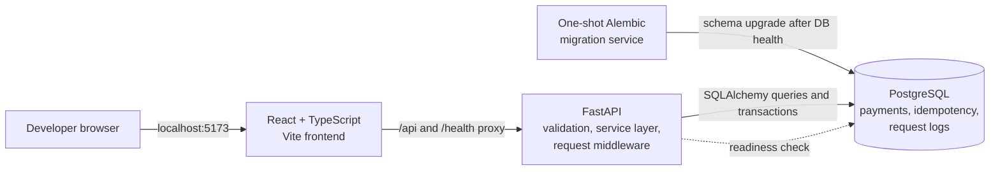

# Vitt Guard

Vitt Guard is a local payment API simulator and developer dashboard. It demonstrates
selected reliability concepts—PostgreSQL persistence, transactional idempotency,
request observability, and database-backed metrics—without initiating or settling
real payments. It is not payment infrastructure and is not production-ready.

## Features

- FastAPI endpoints for simulated payments, request history, metrics, and health.
- PostgreSQL persistence with Alembic-managed schema.
- Transactional idempotency with canonical payload hashing, durable replay, and
  database-enforced uniqueness.
- Request IDs, sanitized request logs, UTC metrics, and deterministic pagination.
- React + TypeScript dashboard with an API Explorer for deliberate create, retry,
  and conflict demonstrations.
- Docker Compose local stack with database, migration, API, and frontend services.
- PostgreSQL-backed integration tests, frontend tests, lint, formatting, type, and
  build checks in GitHub Actions.

No payment-card details are accepted. The service does not call a payment
processor, move money, or create sample records during startup.

## Architecture



Compose binds the frontend, API, and PostgreSQL ports to loopback. The frontend
uses Vite's same-origin proxy; its browser bundle contains no database
credentials. See [docs/architecture.md](docs/architecture.md) for runtime and
trust-boundary details.

## Tech stack

| Area | Technology |
|---|---|
| API | Python, FastAPI, Pydantic |
| Persistence and migrations | SQLAlchemy 2, PostgreSQL 17, psycopg 3, Alembic |
| Frontend | React, TypeScript, Vite, TanStack Query |
| Tests and quality | pytest, real PostgreSQL integration tests, Vitest, Testing Library, Ruff, ESLint, Prettier, TypeScript |
| Local services and CI | Docker Compose, GitHub Actions |

## Prerequisites

- Windows 10/11 and PowerShell.
- Docker Desktop with Docker Compose v2, running.
- Git.
- For optional host-run development: Python 3.10+ and Node.js 22+.

Frontend commands use `npm.cmd` to avoid PowerShell execution-policy issues
with the `npm.ps1` wrapper.

## Local setup (Windows PowerShell)

From the repository root:

```powershell
if (-not (Test-Path .env)) { Copy-Item .env.example .env }
notepad .env
```

Replace each `REPLACE_ME` value in `.env` with a unique, local-only database
name, username, and URL-safe password. `.env` is ignored by Git. Do not use
these development credentials in a shared environment. No usable credentials
are supplied in `.env.example`.

The complete local stack runs in Compose; Python and Node need not be installed
for normal use:

```powershell
docker compose up --build -d
docker compose ps
```

Compose starts PostgreSQL, waits for its health check, runs the one-shot Alembic
upgrade, waits for API readiness, and then starts Vite. Open:

- Dashboard: <http://127.0.0.1:5173>
- API OpenAPI docs: <http://127.0.0.1:8000/docs>
- API readiness: <http://127.0.0.1:8000/health/ready>

The migration service applies schema upgrades on Compose startup; it does not
insert payment data. The API itself does not create tables on startup.

### Start, stop, inspect, and reset

```powershell
# Start or rebuild all local services
docker compose up --build -d

# See status and health
docker compose ps
docker compose logs --tail 100
docker compose logs -f db api frontend migrate

# Stop containers but keep them and the local database volume
docker compose stop

# Remove containers and network; the named database volume remains
docker compose down

# Start again, preserving the existing local database
docker compose up -d

# Inspect PostgreSQL readiness without printing credentials
docker compose exec db sh -lc 'pg_isready -U "$POSTGRES_USER" -d "$POSTGRES_DB"'
```

Stopping containers or running `docker compose down` does **not** delete the
named `postgres-data` volume. To intentionally reset the local database and
permanently delete its persisted data, run this only after confirming the
correct Compose project:

```powershell
docker compose down --volumes
docker compose up --build -d
```

Do not use `--volumes` when you need to retain local records. The new database
will have the schema migrated but contain no payment records. No seed data is
loaded.

### Optional host-run API or frontend

Compose is the recommended local path. For backend code iteration outside the
container, start the Compose database, create `.venv`, install dependencies,
then run the API with the host `DATABASE_URL` in `.env`:

```powershell
docker compose up -d db
py -3 -m venv backend\.venv
.\backend\.venv\Scripts\python.exe -m pip install -e "backend[dev]"
.\backend\.venv\Scripts\python.exe -m alembic -c backend\alembic.ini upgrade head
.\backend\.venv\Scripts\python.exe -m uvicorn app.main:app --app-dir backend --reload
```

For frontend iteration on the host, use a second PowerShell window:

```powershell
Set-Location frontend
npm.cmd ci
npm.cmd run dev
```

Vite proxies `/api` and `/health` to `http://127.0.0.1:8000` by default. Override
that target with `VITE_API_PROXY_TARGET` if the host API uses another address.
`VITE_API_BASE_URL` is optional and public; never place credentials or secrets
in any `VITE_*` variable.

## Database and migrations

Compose uses a named `postgres-data` volume for local persistence. Its `migrate`
service runs `alembic upgrade head` after PostgreSQL is healthy and before the
API starts. To apply migrations manually from the root when running the API on
the host:

```powershell
.\backend\.venv\Scripts\python.exe -m alembic -c backend\alembic.ini upgrade head
```

To inspect the revision from the host:

```powershell
.\backend\.venv\Scripts\python.exe -m alembic -c backend\alembic.ini current
```

For the disposable local database reset, use `docker compose down --volumes`
followed by `docker compose up --build -d`. Alembic downgrades can remove
persisted data; do not run a downgrade against records you intend to keep. See
[docs/data-model.md](docs/data-model.md).

## API

All payments are simulated. `POST /api/v1/payments` requires an
`Idempotency-Key` and stores a record; it does not charge, authorize, transfer,
or settle funds.

| Method | Path | Description |
|---|---|---|
| `POST` | `/api/v1/payments` | Create a simulated payment; requires `Idempotency-Key`, optional `Idempotency-Scope`. |
| `GET` | `/api/v1/payments?limit=20&offset=0` | List payments with bounded pagination. |
| `GET` | `/api/v1/payments/{payment_id}` | Retrieve a payment by its public ID. |
| `GET` | `/api/v1/requests?limit=20&offset=0` | List persisted request attempts. |
| `GET` | `/api/v1/requests/{request_id}` | Retrieve a request attempt by UUID. |
| `GET` | `/api/v1/metrics/summary` | Persisted lifetime aggregates; accepts optional timezone-aware `start` and `end`. |
| `GET` | `/auth/status` | Public frontend bootstrap config; reports whether API authentication is enabled. |
| `GET` | `/auth/verify` | Verifies HTTP Basic credentials when authentication is enabled. |
| `GET` | `/health` | Process liveness. |
| `GET` | `/health/live` | Process liveness, independent of PostgreSQL. |
| `GET` | `/health/ready` | Readiness; checks PostgreSQL and returns an error if unavailable. |

Interactive OpenAPI documentation is at <http://127.0.0.1:8000/docs>.
When `AUTH_ENABLED=true`, every `/api/v1/*` endpoint requires HTTP Basic
authentication. The dashboard prompts for the configured username and
password; it retains them in memory only, and the API verifies credentials on
every request. `/health`, `/health/live`, `/health/ready`, and the frontend
bootstrap endpoint remain public for hosting health checks and initialization.
Production mode requires authentication, a password of at least 32 characters,
and explicit CORS origins.

### Create request and response

PowerShell request:

```powershell
$key = [guid]::NewGuid().ToString()
$body = @{ amount_minor = 2599; currency = "USD" } | ConvertTo-Json -Compress
Invoke-WebRequest `
  -Uri http://127.0.0.1:8000/api/v1/payments `
  -Method Post `
  -Headers @{ "Idempotency-Key" = $key } `
  -ContentType "application/json" `
  -Body $body
```

Request fields are strict: `amount_minor` must be an integer from 1 through
100,000,000; `currency` must be `USD`, `EUR`, or `GBP`; additional fields are
rejected. A new operation returns `201 Created`, with a body shaped like:

```json
{
  "payment_id": "pay_<32 URL-safe characters>",
  "amount_minor": 2599,
  "currency": "USD",
  "status": "pending",
  "created_at": "<timezone-aware timestamp>",
  "updated_at": "<timezone-aware timestamp>"
}
```

Once the payment exists, these read-only PowerShell samples use only implemented
routes:

```powershell
Invoke-RestMethod http://127.0.0.1:8000/health/ready
Invoke-RestMethod "http://127.0.0.1:8000/api/v1/payments?limit=20&offset=0"
Invoke-RestMethod "http://127.0.0.1:8000/api/v1/payments/$($payment.payment_id)"
Invoke-RestMethod http://127.0.0.1:8000/api/v1/metrics/summary
```

To capture the payment from the POST sample as `$payment`, assign the result
from `Invoke-RestMethod` to that variable instead of using `Invoke-WebRequest`.
The sample POST creates a real simulated record in the configured local
database; it is an explicit manual request, not startup seed data.

Each response includes an `X-Request-ID` header. Errors use the documented
`{"error":{"code":"...","message":"..."},"request_id":"<uuid>"}` shape and do
not expose SQL or stack traces. Common statuses are `200` for replay or reads,
`201` for first creation, `404` for missing IDs, `409` for idempotency payload
conflicts, `413` for oversized bodies, and `422` for invalid input.

### Idempotency behavior

Keys are scoped by `Idempotency-Scope` (default `default`) and are case-sensitive.
Keys are 1–255 ASCII characters; the first character must be alphanumeric, and
the remaining characters may be alphanumeric, `.`, `_`, `~`, or `-`. Scope is
1–128 characters with a corresponding bounded ASCII format. Scope is a namespace,
not authentication.

The canonical request consists of validated `amount_minor` and `currency`,
serialized independently of JSON key order and stored as a SHA-256 hash. Same
scope, key, and payload returns the original stored response with `200`;
changing a semantic field returns `409` without creating another payment.
Different scopes have independent keys. Records do not expire automatically.
PostgreSQL's unique constraint and a transaction spanning payment and replay
record persistence protect concurrent requests. If a transaction fails before
commit, both writes roll back; if commit succeeds but the reply is lost, retry
the exact payload with the same key. See
[docs/idempotency-design.md](docs/idempotency-design.md).

### Data model and metrics

`payments` stores simulated state and timestamps. `idempotency_records` stores
the key scope, canonical hash, and original response. `request_logs` stores
sanitized attempt metadata and outcome, not raw bodies or sensitive headers.
All are migrated with Alembic. The metrics API computes aggregates from SQL and
does not load every row into application memory. See
[docs/data-model.md](docs/data-model.md) and [docs/metrics.md](docs/metrics.md).

## Testing and CI

The PostgreSQL integration suite requires a dedicated database whose name ends
in `_test`. It refuses a database that contains rows in the payment,
idempotency, or request-log tables and only removes rows created by its tests.
Never point it at the development database or any database with important data.
Same-key concurrency tests run against real PostgreSQL, not SQLite.

Set `DATABASE_URL` in the current PowerShell process to a dedicated migrated
test database, then run:

```powershell
$env:DATABASE_URL = "postgresql+psycopg://<test-user>:<test-password>@localhost:5432/vitt_guard_test"
.\backend\.venv\Scripts\python.exe -m alembic -c backend\alembic.ini upgrade head
Set-Location backend
.\.venv\Scripts\python.exe -m ruff check .
.\.venv\Scripts\python.exe -m pytest
Set-Location ..\frontend
npm.cmd test -- --pool=threads --maxWorkers=1 --fileParallelism=false
npm.cmd run lint
npm.cmd run format:check
npm.cmd run typecheck
npm.cmd run build
Set-Location ..
```

Replace the test URL placeholders locally; do not commit credentials. See
[docs/testing.md](docs/testing.md) for isolated database setup and exact CI
behavior. GitHub Actions provisions its own PostgreSQL service, migrates it,
and runs backend and frontend checks.

## Screenshots

Screenshots belong in documentation only when captured from the actual running
Vitt Guard frontend. No mockups or fabricated dashboard data are presented as
live results. To capture a local screenshot, start the full Compose stack and
use the operating system's screenshot tool while viewing <http://127.0.0.1:5173>.
The Overview's empty state is expected until a developer creates payments
through the API Explorer or API.

## Limitations and security boundary

Vitt Guard is a local demonstration, not production-ready payment
infrastructure. Local Compose defaults to no authentication and binds services
to loopback. For a hosted single-operator demo, enable the backend HTTP Basic
credential gate; do not put credentials in the frontend bundle or a `VITE_*`
variable. HTTP Basic is only acceptable over HTTPS. The app does not implement
rate limiting, account management, role-based authorization, or shared-user
isolation, so unrestricted public access remains unsafe. A deployment needs a
provider/edge rate limit for authentication and write endpoints, and should
remain password-protected rather than an open public simulator. CORS is a
browser policy, not access control.

The API does not collect card information or connect to a payment processor.
Idempotency and logs demonstrate selected reliability patterns, but do not
provide the broader controls required for a real financial system. See
[docs/security.md](docs/security.md).

## Engineering decisions and trade-offs

- Integer minor units avoid floating-point currency arithmetic; supported
  currencies and amount bounds are intentionally narrow.
- PostgreSQL is used for persistence and concurrency guarantees; SQLite is not
  considered equivalent for idempotency race tests.
- Idempotency records are retained indefinitely to prevent silent key reuse.
  This trades storage growth for durable replay behavior.
- Request logging is best-effort in a separate transaction so optional
  observability failure does not corrupt a payment operation.
- The local Compose stack uses a Vite development server and automatic local
  Alembic upgrades for ease of iteration. This is not a production deployment
  topology or migration rollout strategy.
- Hosted authentication uses a single environment-configured HTTP Basic
  identity. Its credentials are sent on each API request over HTTPS and kept
  only in frontend memory. It is a small-demo access gate, not multi-user
  identity management.
- The UI reports only API-backed data. It does not invent time-series metrics,
  payment records, or successful API results.

## Further documentation

- [Architecture](docs/architecture.md)
- [Data model](docs/data-model.md)
- [Metrics and request observability](docs/metrics.md)
- [Idempotency design](docs/idempotency-design.md)
- [Testing and CI](docs/testing.md)
- [Troubleshooting](docs/troubleshooting.md)
- [Local setup notes](docs/setup.md)
- [Security boundary](docs/security.md)
