# Architecture

Vitt Guard is a developer simulator. It has a browser-based dashboard, an HTTP
API, and PostgreSQL persistence. It has no payment processor, external
financial integration, identity provider, or background payment worker.

## Runtime components

```mermaid
flowchart TD
    subgraph Local["One developer workstation (loopback ports only)"]
        Browser["Browser"]
        Frontend["frontend container<br/>Node 22 + Vite<br/>React + TypeScript"]
        API["api container<br/>FastAPI + Pydantic"]
        Auth["Optional HTTP Basic<br/>backend credential gate"]
        Middleware["Request ID, validation,<br/>sanitized observability middleware"]
        Routes["Thin HTTP routes"]
        Service["Payment and metrics<br/>service layer"]
        ORM["SQLAlchemy sessions<br/>bounded connection pool"]
        Migration["migrate container<br/>Alembic upgrade head"]
        Postgres[("db container<br/>PostgreSQL 17")]
        Volume[("postgres-data<br/>named persistent volume")]
    end

    Browser -->|"http://127.0.0.1:5173"| Frontend
    Frontend -->|"/api and /health via Vite proxy"| API
    API --> Middleware --> Auth --> Routes --> Service --> ORM --> Postgres
    Migration -->|"after PostgreSQL healthy"| Postgres
    Postgres --- Volume
```

The frontend's API client uses same-origin relative paths by default. Vite
proxies `/api` and `/health` to `http://api:8000` inside Compose; direct host
development uses `http://127.0.0.1:8000`. Frontend `VITE_*` values are public
configuration and must not contain secrets.

The FastAPI application uses thin route handlers, Pydantic request/response
schemas, a service layer for payment and aggregate logic, and SQLAlchemy
sessions for database access. Alembic migrations are a separate one-shot
Compose service. Compose only starts the API after that service exits
successfully; it only starts the migration after PostgreSQL is healthy. The API
readiness healthcheck runs a database query. The frontend waits for API health.

## Persisted data

PostgreSQL contains:

- `payments`: one record per new simulated payment operation.
- `idempotency_records`: scoped key, canonical request hash, and stored
  original response.
- `request_logs`: sanitized metadata for API attempts.

No data is seeded at startup. Metrics use SQL aggregates over persisted rows.
See [data-model.md](data-model.md) and [metrics.md](metrics.md).

## Trust boundary

Compose publishes database, API, and frontend ports on `127.0.0.1` only. Local
authentication defaults off. An optional HTTP Basic gate protects API routes
for a hosted single-operator demo, but the app has no rate limiting, multi-user
roles, or user isolation. CORS is not an access-control mechanism. Production
exposure still requires HTTPS, edge rate limiting, backups, and monitoring. The
simulator neither accepts payment-card data nor calls a processor.

## Startup behavior

`docker compose up --build -d` creates the named PostgreSQL volume if missing,
waits for the database healthcheck, applies Alembic migrations to head, then
starts the API and frontend according to dependency health. The local migration
container is an iteration convenience, not a production rollout mechanism.
`docker compose down` preserves the database volume; `docker compose down
--volumes` intentionally removes it and its data.
